  

###

💻 AI Developer focused on LLMs, multi-agent systems and RAG 
🎓 Computer Science student at Fametro 
🏢 AI Development Intern at Sidia Instituto de Ciência e Tecnologia 
☁️ AWS Certified AI Practitioner 
🚀 Always learning and passionate about technology

###

  
  
  
  
  
  
  
  
  
  
  
  
  
  
  
  
  

###

<h3 align="left">🔭 Featured Projects</h3>

- **[System One Model Fine-Tuning](https://github.com/Lucasrrafael/system-one-model-fine-tuning)**: LoRA fine-tuning pipeline for Laya and clef (9B/27B) decision models on ordinal ticket-urgency scoring, with before/after evaluation tracked in MLflow
- **[Foundation RAG](https://github.com/Lucasrrafael/Foundation-Rag-Teste)**: on-device RAG pipeline for iOS
- **[Sonare](https://github.com/Lucasrrafael/Sonare)**: accessibility app using computer vision (YOLOv8 + OpenCV) for product detection

###

Check out my social media:

###

  
  
  
  

###

  
  

  

###

<picture>
  <source media="(prefers-color-scheme: dark)" srcset="https://raw.githubusercontent.com/Lucasrrafael/Lucasrrafael/output/pacman-contribution-graph-dark.svg">
  <source media="(prefers-color-scheme: light)" srcset="https://raw.githubusercontent.com/Lucasrrafael/Lucasrrafael/output/pacman-contribution-graph.svg">
  
</picture>

###

  

